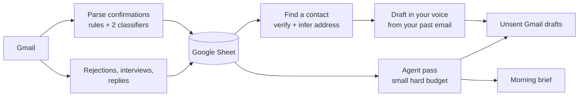

# jobagent

**A job search that keeps its own books.** jobagent watches your Gmail for
applications, rejections, interview invites and replies, keeps a Google Sheet
in sync, finds a real person to contact at each company, and drafts outreach
in your own writing voice. After every scheduled run, an agent reads the whole
search and leaves a morning brief of what needs you first.

It never sends anything. Every email it writes is an unsent Gmail draft that
you read and send yourself.

I built it for my own job search and ran it on that search the whole time.
Most of the design came from something that broke along the way.

| | |
|---|---|
| **Gmail-first** | every application read out of the mailbox rather than typed in |
| **Draft-only** | cold outreach researched and written, never sent automatically |
| **31k** | lines of Python in 140 files, in ten layers |
| **450+** | tests, none of which need a Gmail, Sheets or model credential |

## How it works



1. **Read.** Every few hours it reads new mail. Application confirmations
   become sheet rows; rejections, interview invites and human replies update
   the status. Each hiring system formats its emails differently, so a
   parser handles the common ones and two scikit-learn classifiers catch the
   wording the rules miss.
2. **Research.** For an application with no contact yet, it looks for a real,
   mid-level person on the right team, checks the name against published
   sources, and works out the address from the company's own email pattern.
   Each address is labelled *published*, *delivered to before*, or *inferred*,
   so you know how far to trust it.
3. **Draft.** The email is written from a retrieval index over your own past
   outreach, so it sounds like you, and is checked against how you actually
   write before it becomes a draft.
4. **Judge.** An agent whose only tools are the project's own functions picks
   which cold applications deserve research today, drafts due follow-ups, and
   writes the brief. It has no tool that sends mail, and its budget is a hard
   cap in code.

## Try it

You need Python 3.12+, a Google account, and about fifteen minutes to set up
Google credentials. The tool reads your own Gmail, so each person runs it with
their own Google Cloud project; nothing is hosted.

```bash
git clone https://github.com/ianisnotgoodatjava/jobagent.git
cd jobagent
python3 -m venv venv && source venv/bin/activate
pip install -r requirements.txt && pip install -e .
python cli.py setup     # says which step is next, and stops there
```

`python cli.py setup` walks through the rest: the Google credentials, your
profile and resume details, and creating the tracking sheet in your own
Drive. The [one-time setup](#one-time-setup) section below has the
click-by-click version. After that, `jobagent` works from any folder.

```
python cli.py --help              # every command, grouped by what it does
python cli.py auto                # the full pipeline, once
python cli.py agent --dry-run     # the agent pass, drafting nothing
python cli.py ask "who is waiting on a reply from me?"
python cli.py parser-accuracy     # score the confirmation parser, offline
```

## Built with

Python 3.12 · Gmail, Sheets and Calendar APIs · scikit-learn · Claude (API,
CLI, or an MCP server the project exposes) or Meta's Muse for the research and
writing steps. Everything except research and drafting runs with no model.

The architecture is enforced rather than described: `architecture.py` says
which layer each module belongs to, and a test fails if any import points
upward. `DESIGN.md` explains why the layers are in that order and what each
one was costing before.

## What it does

| | |
|---|---|
| **Keeps the sheet honest** | Reads Gmail and classifies each thread: applied, rejected, interviewing, replied. Two scikit-learn classifiers catch wording the phrase rules miss. |
| **Finds the contact** | Researches a real mid-level person at the company, verifies the name against published sources, and infers the address from the firm's own pattern — reporting whether it's *published*, *previously delivered to*, or *inferred*. |
| **Finds common ground** | After each application, looks for people at the firm who share something with you that *they* published — a school, a language, a sport, a hobby, a club, a background — nearest the role first. You list the traits; a name is never evidence. |
| **Writes in your voice** | Drafts are conditioned on a retrieval index over your own past emails, not a generic template. |
| **Follows up once** | Finds outreach that went quiet past *your measured* follow-up interval and drafts exactly one second touch. Never a third. |
| **Briefs you** | After each scheduled pass, an agent with the tracker's own functions as tools decides which cold applications deserve research, drafts due follow-ups, and writes what needs you first. |

## Engineering highlights

**Learning behaviour instead of assuming it** — `followup_model.py`

The follow-up scheduler needed a wait interval. Rather than pick a round
number, it measures: pair each follow-up with the message before it to the
same person, and the median gap is **7 days**, not the 10 I'd have guessed.

Getting the training labels right mattered more than the model. The obvious
label — "is this a later message in the thread?" — is mostly *replies to
people who had already written back*. Training on those produces a follow-up
that opens "Thanks for getting back to me!" addressed to someone who never
did. The labels come from Gmail thread state instead: a send with no inbound
message before it is a genuine nudge into silence. That distinction is the
whole feature.

**Deriving state instead of storing it** — `followup_scheduler.py`

Every rule reads off the live Gmail thread rather than a local state file:
they replied → skip; two sends of mine already → skip; a pending draft →
skip. Nothing can drift out of sync with what was actually sent, and re-runs
are safe by construction.

**Refusing to guess** — `auto_draft.py`

When no contact can be verified, the run writes a `.SKIPPED` file explaining
why instead of inventing a plausible name. A fabricated detail in a cold
email is worse than no email: the recipient notices.

**Shareable code, private search** — `profile.json`, `resume_bank.json`

The code can be published; the search it ran cannot. Who you are, your resume,
your application answers and every contact you research live in gitignored
files with `.example` templates beside them, and the test fixtures use
invented people throughout. Nothing about the sender is hard-coded -- a
test asserts it -- so anyone can clone this and run their own search without
inheriting someone else's.

## What this deliberately does NOT do


- **No LinkedIn scraping or automation.** LinkedIn's Terms of Service
  prohibit automated data collection, and violating it risks your account.
  `linkedin_helper.py` only builds a search URL — you browse and pick the
  contact yourself, then save what you found with `save-contact`.
- **No auto-sending email.** Every email is created as a Gmail *draft*.
  You always click Send yourself in Gmail.

## Where state lives

Everything the tool keeps for you is in one folder, `JOBAGENT_HOME`. Run
from a checkout, that is the repository root, so a clone keeps working where
it always has. Installed as a package, it is `~/.jobagent`. Set
`JOBAGENT_HOME` to put it anywhere else. `.env`, `profile.json`,
`resume_bank.json`, `credentials.json`, `token.json` and the trained `.pkl`
models live at its top. Every command runs from inside it, so a file you
name on the command line (`--body-file`, `--attach`) is still read from
wherever you typed it.

`jobagent/core/storage.py` declares every file the tool keeps, by kind, and
is the only code that reads or writes one:

- `data/` — what cannot be rebuilt: corrections you made, and the ledgers
  of what was already researched, drafted, claimed and reported. Backed up
  daily to `data/backups/`, fourteen days kept.
- `logs/` — caches rebuilt from Gmail and the web, `people.db`, run logs and
  draft text. Safe to delete.

Writes are atomic, and stores that only ever add are merged under a lock, so
the scheduled run, the MCP server and a command you type can overlap.

```bash
python cli.py state            # every file: kind, records, size, readable?
python cli.py state --backup   # snapshot data/ and people.db now
```

## Tests

```bash
pip install -r requirements.txt
python -m pytest tests/ -q
```

They cover the parts that decide something — how much an email address can
be trusted, which sheet row a saved contact belongs to, and the hand-typed
date formats — and need no Gmail, Sheet or Muse credential to run. Several
encode a bug that actually shipped: the address-confidence tests exist
because the obvious implementation reads the word "inferred" in a research
note and gets the answer exactly backwards.

## One-time setup

```bash
python cli.py setup
```

Tells you which of the steps below are still outstanding, creates `.env`,
`profile.json` and `resume_bank.json` from the examples, and once you have
Google credentials,
`python cli.py setup --create-sheet` makes the tracking sheet in your own
Drive with the right columns and writes its id into `.env`.

### Your identity lives in `profile.json`

The outreach templates need a name, school, degree and employer. Those come
from `profile.json`, which is gitignored; `profile.example.json` has the same
shape with placeholders:

```bash
cp profile.example.json profile.json   # then edit it
```

Nothing about the sender is hard-coded in the source, so the repository can be
published without publishing a CV. If the profile is missing, drafts come out
addressed from `YOUR NAME` rather than from whoever last used the code —
`sender_profile.is_configured()` is the check worth making before a bulk run.

The steps it is checking for:

### 1. Google Cloud project + APIs
1. Go to https://console.cloud.google.com/ and create a new project (or use an existing one).
2. Enable these APIs (search each in "APIs & Services" > "Library"):
   - Gmail API
   - Google Sheets API
3. Go to "APIs & Services" > "OAuth consent screen". Choose **External**,
   fill in the required fields, and add your own Google account under
   **Test users** (keeps it in testing mode, no Google review needed).
4. Go to "APIs & Services" > "Credentials" > "Create Credentials" >
   "OAuth client ID". Choose **Desktop app**. Download the JSON.
5. Rename the downloaded file to `credentials.json` and put it in this
   project's root folder (already gitignored — never commit it).

### 2. Google Sheet
1. Create a new Google Sheet (or use an existing tracker).
2. Copy the Sheet ID from its URL:
   `https://docs.google.com/spreadsheets/d/THIS_PART_IS_THE_ID/edit`
3. Copy `.env.example` to `.env` and paste the ID in:
   ```
   cp .env.example .env
   ```
   Edit `.env` and set `GOOGLE_SHEET_ID`. The tab name defaults to
   `Applications` — rename a tab to that, or change `GOOGLE_SHEET_TAB` in `.env`.

### 3. Python environment
```bash
python3 -m venv venv
source venv/bin/activate
pip install -r requirements.txt
pip install -e .
```

The last line adds a `jobagent` command that works from any folder:
`jobagent watch` is `python cli.py watch`. Python 3.12 or newer.

### 4. Your resume

The tool writes emails and tailored resumes from your own text, so it needs
your details. `resume_bank.json` holds them and is gitignored — it carries a
home address, EEO answers and salary expectations, which is not something to
commit.

```bash
cp resume_bank.example.json resume_bank.json
```

Then fill it in. The example has the same shape with placeholder values.
`background.outreach` and `background.job_search` are short bios that go
into the drafting prompts; `background.evidence` maps posting keywords to a
line of your experience.

### 5. First run (authorizes your Google account)
```bash
python cli.py log-application --job-title "Software Engineer" --company "Acme Corp" \
  --requirements "Python, 3+ yrs" --location "Remote" --link "https://acme.com/jobs/123"
```
A browser window will open asking you to sign in and grant access. After
that, a `token.json` is cached so you won't be prompted again.

## Everyday usage

```bash
# 1. Log a new application
python cli.py log-application --job-title "..." --company "..." --requirements "..." --location "..." --link "..."

# 2. See everything you've logged
python cli.py list

# 3. Get a LinkedIn search link, open it yourself, pick a contact
python cli.py find-contact-link --company "Acme Corp"

# 4. Save the contact you found
python cli.py save-contact --row 2 --name "Jane Doe" --title "Engineering Manager" \
  --linkedin-url "https://www.linkedin.com/in/janedoe"

# 5. Draft an outreach email (ask Claude to help write the copy, save it to
#    a text file, then point --body-file at it)
python cli.py draft-outreach-email --row 2 --to jane@acme.com \
  --subject "Quick question about the SWE role" --body-file outreach.txt

# 6. If the job requires emailing your application in directly
python cli.py draft-application-email --row 2 --to jobs@acme.com \
  --subject "Application: Software Engineer" --body-file cover_letter.txt \
  --attach resume.pdf
```

Both draft commands only create a **Gmail draft** — open Gmail, review, and
send it yourself.

## Status detection

The scanners read Gmail (and, if enabled, Calendar) and keep the Status,
Network, Requirements and Job Description columns current.

```bash
# Rejections -> Status=rejected, or interview-rejected (yellow) when the
# email or its thread shows you had already interviewed.
python cli.py scan-rejections --days 460 --dry-run

# Interview invites and real human replies -> Status=interviewing,
# Network=TRUE. Also upgrades an already-rejected row to interview-rejected
# when the thread proves you got to a conversation.
python cli.py scan-replies --days 460 --dry-run

# Email yourself a reminder about anything new that is waiting on a reply.
# Sends only to your own address, resolved from the authenticated account.
python cli.py scan-replies --notify
```

### Warm leads that went cold

The opposite of `follow-ups`. That finds outreach nobody answered; this finds
threads where someone at the company *did* answer and then it went quiet with
no rejection — the leads easiest to lose. Mirae Asset replied twice in June,
went silent, and had never made it onto the sheet at all.

```bash
python cli.py reach-out-again --min-silent 21
```

`WARM` means someone offered a call in that thread. The nightly run emails you
the warm ones.

### Google Calendar (optional, strongest evidence)

Email wording is inference; a calendar event is a record. Grant read-only
access once — it is kept out of the default scopes so the nightly run never
stops on a browser consent:

```bash
python cli.py enable-calendar
```

### The learned models

`scan-rejections` falls back to a classifier when no phrase matches, and a
second model judges whether a rejection followed an interview. The second one
is trained on labels taken from your **calendar**, not from the phrase rules,
so it can learn wording the rules never had:

```bash
python cli.py train-rejection-model
python cli.py train-interview-model     # needs enable-calendar first
```

## Application prep package

Everything up to the submit button. It never logs into an ATS or clicks
anything — you paste, upload and decide.

```bash
# From a URL (works on simple career pages)
python cli.py prep --url "https://..." --row 242

# Workday / LinkedIn / Salesforce block scripted requests or render in
# JavaScript. Open the posting, select all, paste into a .txt, then:
python cli.py prep --text-file posting.txt --row 242

# Cover letters are opt-in
python cli.py prep --text-file posting.txt --row 242 --cover-letter
```

Writes `prep/<row>_<company>_<role>/` containing `job.md` (parsed
requirements), `resume_bullets.md` (which of your real bullets to lead with,
ranked for this posting), `ats_answers.md` (work authorization, why this
company, salary, relevant project) and optionally `cover_letter.md`. It also
fills the row's Job Description, Requirements and Job Link.

It also drops a **tailored one-page PDF resume** in the same folder, built
from `resume_bank.json`. Every line is your own text, copied verbatim —
tailoring is *selection and ordering* (which bullets lead, which get cut to
hold one page), never rewriting. A generator that reworded your experience per
posting would invent a record you cannot defend in the interview. Every role
stays on the page; only bullets are cut, and never a role's last one.

Bullet tailoring is per **category** (equity research, sales & trading,
investment banking, quant/data, risk/credit), not per posting — the same
handful of bullets serves every role in a category. Edit `resume_bank.json` to
change the bullets or their matching tags.

### Paste a posting, get the skills line tailored

The skills line is tailored per **posting** (`jobagent/core/skills.py`). Copy
a posting and run `tailor`. The skills it asks for move to the front, and
skills your own bullets prove are added when the posting names them — each
one with its proof: a tag on one of your bullets, or a certification. A
skill the posting wants that you cannot show is listed as a gap in the
terminal, never printed. None of your listed skills is ever dropped, and the
page stays one page.

```bash
python cli.py tailor                         # the posting on the clipboard
python cli.py tailor --watch --open          # every posting you copy, until Ctrl-C
python cli.py tailor --text-file posting.txt --company "Acme" --role "Credit Analyst"
```

```
Skills: Excel, SQL, Valuation, Python, Bloomberg, Tableau, PowerPoint
  moved up, the posting asks for them: Excel, SQL
  added Valuation — your bullet 'pricing-analysis' is tagged with it
  added Bloomberg — certification: Bloomberg Terminal Training
  asked for, not on the page (no evidence): FactSet
```

`prep` tailors the same way, and the agent's `tailor_resume` tool means you
can paste a posting into Claude and get the PDF back.

```bash
# Just the resumes, one per category, without a posting
python -c "from jobagent.apply import resume_pdf; [resume_pdf.build(c) for c in ('equity_research','sales_trading','investment_banking','quant_data','risk_credit')]"
```

```bash
# Fill the Job Description column across the whole sheet
python cli.py backfill-job-descriptions --dry-run
```

## The nightly run

A launchd agent runs `run_auto.sh` on a schedule. `install` fills in
`jobtracker.plist.example` with this machine's paths, writes it to
`com.<you>.jobtracker.plist` in `JOBAGENT_HOME`, and prints it. With `--load`
it also copies it to `~/Library/LaunchAgents` and loads it, replacing a job
already loaded under that name. It ends with the `claude mcp add` line below:

```bash
python cli.py install          # write it and look it over
python cli.py install --load   # and schedule it
```

The template fires at 06:00, 18:00 and 23:00. Each run does the full
pipeline: new applications, rejections, replies and networking, Job
Description backfill, sort, colour, and the reach-out reminder email.

**launchd cannot wake a sleeping Mac.** If the machine is asleep when a run
is due, it is deferred until the Mac next wakes — which is how the 2026-08-03 run died,
firing on wake before the network was up. Each step now retries once and then
skips rather than taking the whole pipeline down, but for it to genuinely run
overnight you need a wake schedule (this needs your password, so run it
yourself):

```bash
sudo pmset repeat wakeorpower MTWRFSU 03:10:00
```

Check it took with `pmset -g sched`. Without that, keep the lid open or leave
the Mac plugged in and awake.

## The agent

The pipeline above does everything a rule can decide. What it cannot do is
judge: which of thirty cold applications is worth a research request today,
which thread to answer first, which sheet row is junk. After each scheduled
pass, `run_auto.sh` starts an agent for that — a model whose only tools are
this project's own functions (`jobagent/agent/toolbox.py`):

- **reads** the pipeline summary, unanswered threads, drafts waiting,
  follow-ups due, applications without a draft, and the people database;
- **acts**, within a budget: researches up to 3 of the best drafting gaps
  and drafts up to 5 due follow-ups — all as unsent Gmail drafts, through the
  same guarded paths the pipeline uses;
- **writes a brief** to `logs/briefs/`: what needs you first, what is ready
  to send, the pipeline in one line, and anything that looked wrong.

The rules are code, not prompt. There is no tool that sends mail. Rows from
before 2026, closed applications, junk rows and firms that already have a
draft are refused with a reason, and the budget is a hard cap.

```bash
python cli.py agent --dry-run --force   # rehearse: drafting tools only report
python cli.py agent --max-drafts 5      # a bigger budget for one pass
python cli.py agent --email             # also email the brief to yourself
python cli.py ask "which interviews do I have coming up?"
```

One brief a day: the first pass that runs writes it and later passes skip,
so a Mac asleep at 06:00 still gets one at 18:00. The agent runs on Claude —
the `claude` CLI with this project's MCP server attached, or the API with
the same tools in-process.

### Talk to the tracker from Claude

The same tools are an MCP server (`jobagent/agent/mcp_server.py`, plain stdio, no
extra dependency). Register it once and Claude Code or Claude Desktop can
answer questions about the search and draft on request, under the same
guards:

```bash
python cli.py llm-status    # prints the exact `claude mcp add` line and the Desktop config
python cli.py agent-serve   # the server itself, for any other MCP client
```

## Writing the email copy

Two routes, both ending in a draft you review.

**Write it yourself.** Save the text to a `.txt` and pass `--body-file` to
`draft-outreach-email`.

**Let it research and draft.** `auto-draft` finds the contact, verifies them
against published sources, and writes the email conditioned on your own past
outreach:

```bash
python cli.py auto-draft --days 45 --limit 5
python cli.py auto-draft --prefer 'real estate|CRE|mortgage'   # a sector first
python cli.py auto-draft --exclude 'some-company'              # leave one out
python cli.py auto-draft --redo                                # re-research done rows
```

It needs a model with web search, and takes whichever is configured
(`jobagent/sources/llm.py`): Meta's Muse Spark (`MODEL_API_KEY`), Claude over the API
(`ANTHROPIC_API_KEY`), or Claude on a subscription through the signed-in
`claude` CLI — no key at all. With more than one, a failure on one falls
through to the next. `python cli.py llm-status` says which will answer.
Research lands in `logs/drafts/auto/` as text first — turn that
into sheet contacts and Gmail drafts with `stage-drafts`, which re-reads the
saved research rather than paying to research again.

## Common ground at the company

A cold email lands differently when it opens on something shared. After an
application lands on the sheet, `watch` checks the firm once for people who
share something with you, nearest the role first: same team, then same
function, then anyone there. Any seniority, since a peer with something in
common is the likeliest reply of all.

What counts as shared is yours to say. The schools, languages and employers
in `resume_bank.json` are used as they are; anything else goes in a
`common_ground` list in `profile.json`. Both files are gitignored, because
what you have in common with people says who you are:

```json
"common_ground": [
  {"kind": "sport",    "label": "rowing", "terms": ["rowing", "rower", "crew"]},
  {"kind": "hobby",    "label": "chess"},
  {"kind": "language", "label": "Portuguese"},
  {"kind": "group",    "label": "Toastmasters"},
  {"kind": "place",    "label": "Lisbon", "terms": ["Lisbon", "Lisboa"]}
]
```

`kind` is one of heritage, group, school, language, sport, hobby, employer or
place. `terms` are the phrases a bio would use. For a one-off search, add
traits on the command line, or search only for those:

```bash
python cli.py common-ground --row 242                     # one application
python cli.py common-ground --company "Normere's" --role "Credit Analyst"
python cli.py common-ground --row 242 --trait sport:rowing --trait hobby:chess
python cli.py common-ground --row 242 --trait language:Portuguese --only
python cli.py common-ground --row 242 --links-only        # free: searches to open yourself
python cli.py common-ground --days 14 --dry-run           # what the sweep would check
python cli.py watch --no-common-ground                    # skip it for one pass
```

A connection has to be something the person published about themselves,
with the URL that says so. `jobagent/core/shared_traits.py` turns down the
guesses. It never accepts a name or a photo as evidence of anyone's
background, nationality or religion, or a market someone *covers*
("covers Portuguese banks" is not "grew up in Lisbon"). It also rejects
anything that names none of your traits. Each refusal is counted with its
reason.

It costs one model request per application, at most five per pass. It runs
once per application and set of traits, so adding a trait is a reason to
look again. A firm checked in the last 30 days isn't re-billed for a second
role. With no model you still get the LinkedIn and web searches. LinkedIn is
only linked to, never fetched. Findings go to `data/common_ground.json`,
outside the repository, so real people's names stay out of it.

## Following up

```bash
python cli.py schedule-followups            # who is due, nothing written
python cli.py schedule-followups --draft    # draft one second touch each
```

The wait defaults to your own measured median rather than a round number.
See `followup_model.py`; `python followup_model.py` prints what it learned
from your mail.
